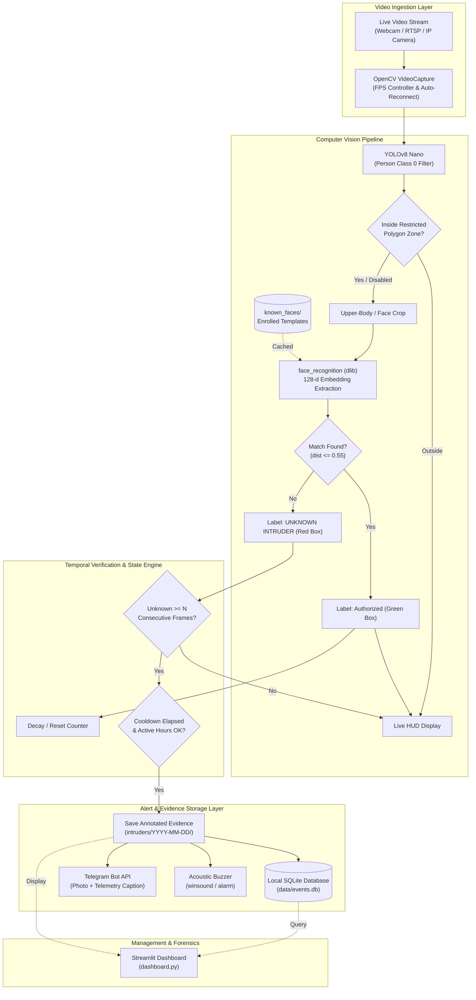

# 🛡️ AI-Based Intruder Detection and Alert System

An autonomous, edge-computing, computer vision security system designed for college capstone projects and smart-facility monitoring. The system continuously analyzes camera streams in real time, detects human presence using **YOLOv8**, identifies authorized personnel versus unknown intruders via **128-dimensional facial embedding recognition**, archives forensic evidence snapshots locally, and instantly dispatches alerts with evidence photos via the **Telegram Bot API**.

---

## 🌟 Key Features

- **Real-Time Human Detection:** Powered by Ultralytics YOLOv8 nano (`yolov8n.pt`) with class-specific human filtering and configurable confidence thresholds.
- **Biometric Face Recognition:** Fast face localization and 128-d Euclidean embedding comparison against pre-enrolled authorized templates in `known_faces/`.
- **Intruder Temporal Verification:** Prevents spurious alarms by requiring an unknown person to persist for $N$ consecutive frames (configurable, default: 5 frames).
- **Zero-Cloud Local Evidence Vault:** Saves high-resolution, annotated snapshots with bounding boxes, confidence tags, and timestamp watermarks to local dated directories (`intruders/YYYY-MM-DD/`).
- **Instant Telegram Photo Alerts:** Asynchronously uploads the exact evidence JPEG photo and telemetry caption directly to your Telegram chat using standard HTTP POST multipart requests.
- **Local Audio Buzzer:** Non-blocking audible alarm pulse (using Windows `winsound` or system bell) to deter intruders on-site.
- **Alert Cooldown System:** Configurable cooldown timer (default: 30s) prevents notification flooding during continuous motion.
- **Restricted Virtual Fence (Polygon Zone):** Optional configurable polygonal boundary; alerts only trigger if an unrecognized person steps inside the zone.
- **Active Hours Scheduling:** Optional scheduled monitoring window (e.g., 22:00 to 06:00) with automatic midnight-crossing support.
- **Automated Data Retention & Pruning:** Automatically deletes snapshot directories and SQLite records older than a configurable number of days (default: 30 days).
- **Interactive Face Enrollment CLI:** Easily enroll authorized staff/family with 5-angle calibration via `register_face.py`.
- **Streamlit Analytics Dashboard:** Local web UI featuring live system process controls, KPI cards, 24-hour activity bar chart, filterable event table, CSV export, and evidence image gallery with one-click deletion.

---

## 📐 System Architecture



---

## 📂 Project Directory Structure

```text
intruder-detection/
├── app.py                  # Main real-time detection and alerting loop
├── detector.py             # YOLOv8 person detector + face recognition matcher
├── alerts.py               # Telegram photo dispatch, alarm buzzer, cooldown engine
├── database.py             # Thread-safe SQLite event logging and analytics
├── dashboard.py            # Streamlit web monitoring dashboard
├── config.py               # Centralized configuration and path management
├── register_face.py        # Interactive CLI tool to enroll authorized faces
├── test_pipeline.py        # End-to-end integration and unit test suite
├── check_webcam.py         # Diagnostic utility to verify camera connectivity
├── requirements.txt        # Pinned dependencies for Python 3.10 / 3.11
├── .env.example            # Environment variables template
├── .env                    # Local secrets (Telegram tokens, camera source)
├── data/
│   └── events.db           # SQLite database for forensic event records
├── models/
│   └── yolov8n.pt          # Ultralytics YOLOv8 nano model weights
├── known_faces/            # Enrolled authorized personnel folders
│   ├── Alice/
│   └── Bob/
├── intruders/              # Saved evidence snapshots organized by date
│   └── 2026-10-18/
│       └── intruder_20261018_143000.jpg
└── clips/                  # Optional video clips directory
```

---

## ⚙️ Installation & Setup

### Prerequisites
- **Python 3.10 or 3.11** is recommended for cross-platform precompiled wheel compatibility.
- A functional USB webcam or RTSP camera network stream.

### 1. Clone & Set Up Virtual Environment

#### On Windows (PowerShell):
```powershell
# Clone or navigate to the project directory
cd c:\Users\AFIZ\Documents\ooad-project

# Create a virtual environment using Python 3.11
uv venv .venv --python 3.11
# Or using standard python:
# python -m venv .venv

# Activate the virtual environment
.\.venv\Scripts\activate
```

#### On Linux / macOS (Bash):
```bash
python3.11 -m venv .venv
source .venv/bin/activate
```

### 2. Install Dependencies

```bash
# If using uv (extremely fast):
uv pip install -r requirements.txt

# Or using standard pip:
pip install -r requirements.txt
```

> [!NOTE]
> **Windows dlib note:** On Windows, `requirements.txt` specifies `dlib-bin`, which provides pre-compiled 64-bit binary wheels. This avoids requiring Visual Studio C++ build tools or CMake installation. On Linux/macOS, standard `dlib` builds automatically.

---

## 🤖 Configuring Telegram Alerts

1. Open Telegram and search for **[@BotFather](https://t.me/BotFather)**.
2. Send `/newbot`, follow the prompts, and copy the provided **HTTP API Bot Token**.
3. Search for **[@userinfobot](https://t.me/userinfobot)** and start it to obtain your numeric **Id** (this is your `TELEGRAM_CHAT_ID`).
4. Copy `.env.example` to `.env` and fill in your values:

```env
TELEGRAM_BOT_TOKEN=123456789:ABCdefGhIJKlmNoPQRsTUVwxyZ
TELEGRAM_CHAT_ID=987654321
CAMERA_SOURCE=0
```

---

## 👤 Enrolling Authorized Personnel

To teach the system who is authorized (so they are labeled with a green bounding box and do not trigger alarms):

```bash
python register_face.py --name "Alice"
```

1. Look directly at the webcam within the highlighted box.
2. Press **`SPACE`** to snap each of the 5 calibration photos from different angles (straight, slight left, slight right, smiling).
3. The photos will be stored under `known_faces/Alice/`.
4. When `app.py` is running, press **`R`** on the keyboard at any time to hot-reload newly enrolled faces without restarting the camera!

---

## 🚀 Running the System

### 1. Verify Pipeline & Camera Diagnostics
Run the automated integration tests:
```bash
python test_pipeline.py
```

Test webcam capture:
```bash
python check_webcam.py
```

### 2. Start the Live Intruder Detection Engine
```bash
python app.py
```
- **HUD Preview:** Real-time FPS, active hours status, cooldown timer, and tracking progress.
- **Controls:**
  - Press **`Q`** or **`ESC`** to exit cleanly.
  - Press **`R`** to hot-reload face encodings from `known_faces/`.

### 3. Launch the Streamlit Monitoring Dashboard
In a separate terminal (with virtual environment active):
```bash
streamlit run dashboard.py
```
Open your browser at `http://localhost:8501`:
- **System Controller:** Start or stop the detection engine with one click from the sidebar.
- **Metrics Cards:** Intruders today, past 7 days, and all-time statistics.
- **Hourly Chart:** 24-hour distribution of intrusion activity.
- **Evidence Gallery:** Inspect high-resolution snapshot photos with timestamps and bounding boxes.
- **Event Management:** Filter by date, export event logs to CSV, or delete individual events and their associated disk files.

---

## 🔧 Configuration (`config.py`)

All customizable options are centralized in `config.py`:

| Parameter | Default | Description |
|---|---|---|
| `CAMERA_SOURCE` | `0` | Camera device index (`0`, `1`) or RTSP/HTTP URL |
| `YOLO_CONFIDENCE_THRESHOLD` | `0.50` | Minimum confidence score to register a person detection |
| `FACE_MATCH_TOLERANCE` | `0.55` | Stricter face matching threshold (lower = stricter; 0.6 is default) |
| `CONSECUTIVE_FRAMES_THRESHOLD` | `5` | Frames an unknown person must persist before triggering alert |
| `ALERT_COOLDOWN_SECONDS` | `30` | Cooldown period between alert dispatches |
| `PROCESS_EVERY_N_FRAMES` | `3` | Face recognition cadence for optimal CPU FPS |
| `ENABLE_AUDIO_ALARM` | `True` | Sound acoustic buzzer upon intruder detection |
| `RESTRICTED_ZONE_ENABLED` | `False` | Restrict alarms to a specific polygon zone |
| `RESTRICTED_ZONE_POLYGON` | `[(100,100), ...]` | Polygon coordinates defining the virtual perimeter |
| `ACTIVE_HOURS_ENABLED` | `False` | Restrict alerting to a scheduled time range |
| `ACTIVE_HOURS_START` | `"22:00"` | Active hours start time (24-hr format) |
| `ACTIVE_HOURS_END` | `"06:00"` | Active hours end time (handles midnight rollover) |
| `RETENTION_DAYS` | `30` | Automatic deletion threshold for snapshots and database records |

---

## 🔍 Troubleshooting

### 1. `dlib` Installation Issues
- **Windows:** If `pip install dlib` fails with `CMake Error: You must use Visual Studio to build a python extension`, use the precompiled binary:
  ```powershell
  pip install dlib-bin
  ```
- **`setuptools` Incompatibility:** If you see `ModuleNotFoundError: No module named 'pkg_resources'`, install `setuptools<70`:
  ```powershell
  pip install "setuptools<70"
  ```
- **Linux (Ubuntu/Debian):**
  ```bash
  sudo apt-get update && sudo apt-get install -y build-essential cmake libopenblas-dev liblapack-dev
  pip install dlib
  ```
- **macOS:**
  ```bash
  brew install cmake
  pip install dlib
  ```

### 2. Camera Fails to Open
- Check if another application (Teams, Zoom, browser) is locking the webcam.
- Test with `python check_webcam.py`.
- If using an external USB webcam, change `CAMERA_SOURCE = 1` in `.env`.

### 3. Telegram Alerts Not Arriving
- Verify both `TELEGRAM_BOT_TOKEN` and `TELEGRAM_CHAT_ID` are defined in `.env`.
- Ensure you have opened your bot in Telegram and clicked **Start** (`/start`). A bot cannot message a user who has never started a conversation with it.

---

## 📜 Academic Attribution
Developed as an academic capstone demonstration combining edge computer vision (YOLOv8), biometric facial verification (dlib embeddings), asynchronous alerting, and local privacy-preserving storage architectures.
